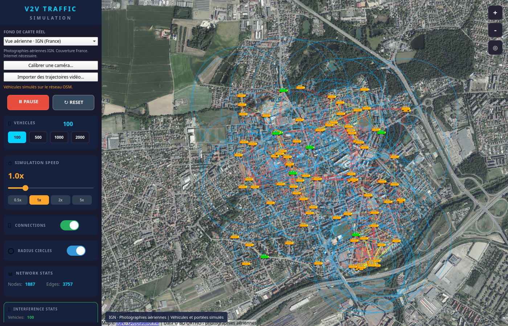
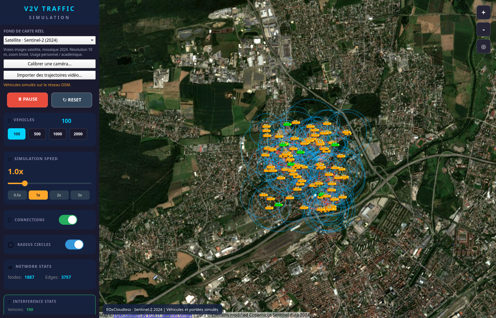
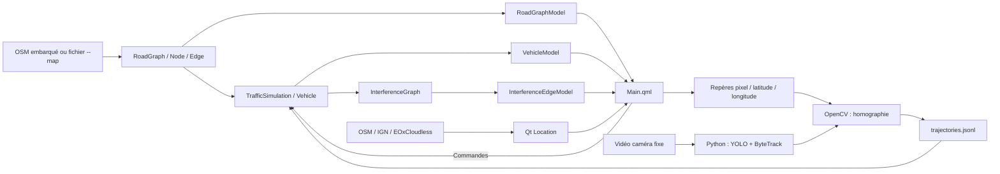

# V2V Traffic Simulation

**Mobilité OpenStreetMap, imagerie réelle et trajectoires vidéo — C++17 · Qt6 · QML · Python**

Projet personnel de transports intelligents : une application de bureau anime des véhicules sur un réseau routier réel et visualise leurs liens de portée simulés. Une extension Python détecte et suit des véhicules filmés, puis exporte leurs trajectoires pour Qt après calibration de la caméra.

[Présentation et téléchargements](https://v2v-traffic-observatory.freshdog256.chatgpt.site) · [Dépôt GitHub](https://github.com/arabat-med/v2v-traffic-simulation) · [Captures réelles](docs/images/README.md) · [Données et dépendances](THIRD_PARTY_NOTICES.md)

## Contexte et objectif

Le projet explore le lien entre mobilité et connectivité à travers un graphe routier OSM et un graphe de portée entre véhicules. Il permet de faire varier la population, de suivre les déplacements et d'afficher les connexions dans une seule interface Qt Quick.

**Le programme est un prototype de bureau exécutable.** Le modèle V2V est géométrique : il ne simule ni émission de messages, ni protocole réseau, ni propagation radio physique. La page web présente le projet et distribue les fichiers ; elle n'exécute pas la simulation dans le navigateur.

## Interface réelle



*Capture réelle du 30 octobre 2026 : Ubuntu 24.04, Qt 6.8.3, Bourtzwiller, 100 véhicules simulés. Fond photographique © IGN ; ces véhicules ne sont pas extraits de l'image aérienne. Les compteurs ne constituent pas un benchmark.*

<details>
<summary>Voir la vraie vue satellite Sentinel-2</summary>



*EOxCloudless https://cloudless.eox.at by EOX IT Services GmbH (Contains modified Copernicus Sentinel data 2024). Mosaïque de 2024, pas une image en direct. Résolution source 10 m ; conditions d'usage dans les notices.*

</details>

## Fonctionnalités de simulation

| Fonctionnalité | État réel | Sources |
| --- | --- | --- |
| Lecture d'un sous-ensemble OSM et construction d'un réseau orienté | Implémenté ; parseur limité | [roadgraph.cpp](roadgraph.cpp), [node.h](node.h), [edge.h](edge.h) |
| Petite carte réelle embarquée et carte externe via `--map` | Implémenté et lancement vérifié | [main.cpp](main.cpp), [data/demo.osm](data/demo.osm) |
| Route, vue aérienne IGN ou satellite Sentinel-2 | Implémenté ; tuiles et captures vérifiées | [Main.qml](Main.qml), [map-providers/](map-providers/) |
| Saisie de repères caméra / carte et lecture des trajectoires | Implémenté ; calibration terrain à réaliser avec la caméra choisie | [CalibrationDialog.qml](CalibrationDialog.qml), [trajectoryreplay.cpp](trajectoryreplay.cpp) |
| Points de création pondérés, parcours aléatoires et positions interpolées | Implémenté | [trafficsimulation.cpp](trafficsimulation.cpp), [vehicle.cpp](vehicle.cpp) |
| Démarrage, pause, reset, population, zoom et recentrage | Implémenté ; lancement et rendu vérifiés, recette interactive complète à poursuivre | [Main.qml](Main.qml) |
| Liens de portée, cercles et statistiques de degré | Implémenté ; recalcul différé et plafond de 5 000 liens | [interferencegraph.cpp](interferencegraph.cpp) |
| Circulation préférentielle par zone | Partiel : les zones sont calculées, mais ne contraignent pas le choix des arêtes | [vehicle.cpp](vehicle.cpp) |
| Communication V2V par paquets ou messages | Absente | Aucun composant correspondant |

Le moteur crée 20 véhicules au démarrage, en pause. L'interface propose 100, 500, 1 000 ou 2 000 véhicules et un facteur temporel de 0,1× à 5×. Ces valeurs sont des réglages, pas des performances garanties.

En mode simulation aléatoire, chaque véhicule reçoit un rayon entre 100 et 500 mètres. Un lien non orienté est créé si `distance <= max(rayon1, rayon2)`. Sa force vaut `1 - distance / max(rayon1, rayon2)` et pilote la couleur : vert au-dessus de 0,7, jaune au-dessus de 0,4, rouge sinon. Il ne s'agit pas d'une mesure de qualité radio ou d'une portée mutuelle vérifiée dans les deux sens.

## Extension Computer Vision

**Une extension locale de détection, suivi et projection caméra → carte est implémentée.** Elle fonctionne dans un processus Python séparé, puis transmet ses résultats à Qt par un fichier de trajectoires. Elle n'est pas déployée comme service web.

| Technologie | Statut |
| --- | --- |
| Python, YOLO11n / Ultralytics, ByteTrack, OpenCV | Traitement vidéo implémenté et testé sur un extrait routier réel |
| Calibration caméra fixe et sol plan | Homographie implémentée et testée ; précision terrain à valider sur la caméra choisie |
| Intégration Python → Qt | Export / import JSON Lines et lecture sur la carte ; aucun flux caméra en direct |
| FastAPI / Uvicorn, Docker / Compose, MLflow | Absents ; non requis pour ce fonctionnement local |
| Service de vision hébergé | Absent |

Voir le [guide caméra → Qt](vision/README.md) : installation, extraction d'image, saisie des repères, traitement vidéo et import. Sans calibration, le module produit des détections en pixels et une vidéo annotée ; il ne fabrique aucune position GPS.

Les poids préentraînés sont téléchargés au premier traitement ou fournis localement. Aucun modèle entraîné pour ce projet, vidéo privée ou notebook n'est inclus. Les tests géographiques utilisent des repères synthétiques explicitement identifiés et ne valident aucune précision sur le terrain.

## Stack vérifiée

- **C++17** : graphes, mobilité et calculs géographiques.
- **Qt 6.8+ / Qt Quick / QML** : fenêtre, propriétés, signaux, modèles et contrôles.
- **Qt Location / Positioning** : carte, coordonnées, polylignes et cercles ; fournisseurs OSM, IGN et EOxCloudless.
- **CMake / Ninja / CTest** : construction et vérifications.
- **OpenStreetMap XML** : réseau routier local.
- **HTML / CSS** : vitrine statique séparée de l'application.
- **Python 3.12 / PyTorch CPU / Ultralytics / ByteTrack / OpenCV / NumPy** : traitement vidéo optionnel ; [dépendances](vision/requirements.txt).
- **Python 3, bibliothèque standard uniquement** : le script d'export des sources reste indépendant de la vision.

## Architecture réelle



Les composants C++/QML fonctionnent dans un processus Qt. Le traitement Python s'exécute séparément et exporte un fichier, ensuite ouvert dans Qt. Les échanges C++/QML utilisent les modèles, propriétés, signaux et méthodes `Q_INVOKABLE`.

Le réseau de déplacement est embarqué ou lu sur disque. Le fond cartographique est fourni séparément par Qt Location et peut nécessiter Internet. Les arêtes de `RoadGraphModel` ne sont pas dessinées comme une couche routière dédiée.

En lecture vidéo, les observations remplacent les déplacements aléatoires. Les connexions restent calculées par le modèle géométrique V2V, avec une portée simulée de 200 m par défaut. Voir les [sources et conditions de l'imagerie](map-providers/README.md).

## Organisation des sources

```text
CMakeLists.txt              Construction, tests et installation
main.cpp / Main.qml        Initialisation et interface
CalibrationDialog.qml     Saisie des repères caméra / carte
calibrationwriter.* / trajectoryreplay.*
roadgraph.* / node.* / edge.*
vehicle.* / trafficsimulation.*
roadgraphmodel.* / vehiclemodel.* / interferencegraph.*
data/                      Petite carte réelle et provenance
map-providers/             Fonds réels et attributions
vision/                    Détection, suivi, homographie et guide
tests/                     Vérifications du moteur
scripts/package-source.py  Export propre, sans historique Git
web/                       Vitrine HTML/CSS
README.md / THIRD_PARTY_NOTICES.md
docs/images/               Capture réelle et guide
.github/workflows/ci.yml    Construction et tests GitHub Actions
```

L'archive préparée contient les sources utiles, la documentation, la capture et la petite carte. Elle exclut `build/`, `.git/`, les réglages IDE, les SDK, les dépendances installées, les exécutables et les grandes cartes d'origine. Aucun fichier local historique n'est supprimé par l'export.

## Installation, compilation et exécution

### Application Linux téléchargeable

Le paquet **Linux x86_64**, disponible sur la [page de présentation](https://v2v-traffic-observatory.freshdog256.chatgpt.site), inclut le runtime Qt partagé et la carte de démonstration. Une session graphique est nécessaire. Validation effectuée sur Ubuntu 24.04 ; aucune distribution Windows ou macOS n'est annoncée.

```bash
tar -xJf v2v-linux-x86_64.tar.xz
cd v2v-traffic-simulation-linux-x86_64
./bin/appfinalproduct
```

### Construire les sources

Prérequis : compilateur C++17, CMake ≥ 3.16, Ninja et SDK Qt 6.8+ avec **Quick, Quick Controls 2, Location et Positioning**, y compris les imports QML **QtQuick.Dialogs** et **QtQuick.Layouts**. Qt Creator est facultatif. Python et ses bibliothèques de vision servent uniquement au traitement vidéo. Adapter le chemin du SDK :

```bash
git clone https://github.com/arabat-med/v2v-traffic-simulation.git
cd v2v-traffic-simulation
cmake -S . -B build/linux-release -G Ninja \
  -DCMAKE_BUILD_TYPE=Release \
  -DCMAKE_PREFIX_PATH="/chemin/vers/Qt/6.8.3/gcc_64"
cmake --build build/linux-release --parallel 2
ctest --test-dir build/linux-release --output-on-failure
./build/linux-release/appfinalproduct
```

La carte `data/demo.osm` est embarquée : ni la grande carte locale ni un répertoire courant particulier ne sont nécessaires au lancement par défaut. Les cartes d'origine restent facultatives et ne sont plus des ressources CMake obligatoires.

```bash
./build/linux-release/appfinalproduct --map /chemin/vers/carte.osm
./build/linux-release/appfinalproduct --vehicles 100 --autostart
./build/linux-release/appfinalproduct --basemap aerial
./build/linux-release/appfinalproduct --basemap satellite
./build/linux-release/appfinalproduct --tracks /chemin/vers/trajectories.jsonl --autostart
./build/linux-release/appfinalproduct --help
```

Utiliser un répertoire de construction propre pour chaque système. Pour une installation incluant Qt, configurer avec `-DV2V_BUNDLE_QT=ON`, puis utiliser `cmake --install`. Avec le SDK Qt 6.8.3 vérifié, choisir un chemin de **construction sans espaces** pour cette étape : son script de déploiement génère une commande incorrecte lorsque ce chemin contient un espace.

## Démonstrations et vérifications

La version préparée a été construite avec **GCC 13.3.0, CMake 3.28.3, Ninja 1.11.1 et Qt 6.8.3** sur Ubuntu 24.04.

- `simulation_core` : chargement de la vraie carte, rejet de données vides/invalides, arêtes orientées, déplacement et graphe de portée.
- `application_smoke` : création de la fenêtre QML et initialisation du graphe après démarrage, en mode sans affichage.
- **Cinq tests CTest passés** : moteur et lecture temporelle, démarrages route / aérien / satellite et import de trajectoires. Les données de lecture du test sont synthétiques et signalées comme telles.
- **Cinq tests Python passés** : projection d'un plan connu, refus des points incohérents, alignés, manquants ou non finis, et absence d'extrapolation hors de la zone calibrée.
- Inférence réelle sur 30 images d'un extrait routier de démonstration Ultralytics : 200 observations et 9 identifiants de suivi. Ce sont des comptes de sortie, sans vérité terrain ni benchmark. La projection de cet essai utilise une calibration synthétique ; elle ne représente pas la localisation réelle de la scène filmée. [Provenance et empreintes de cet essai](docs/validation/vision.json).
- Les captures ont été produites par le programme et inspectées visuellement. GitHub Actions vérifie la compilation et la calibration ; il ne mesure pas la précision d'une caméra réelle.

```bash
QT_QPA_PLATFORM=offscreen QT_QUICK_BACKEND=software \
  ./build/linux-release/appfinalproduct --smoke-test
./build/linux-release/appfinalproduct --vehicles 100 \
  --basemap aerial --screenshot docs/images/02-vue-aerienne-ign.png
python -m unittest discover -s vision/tests -v
python3 scripts/package-source.py
```

Le dernier script produit `build/distribution/v2v-source.zip` avec un manifeste SHA-256 des fichiers. Voir le [guide de capture](docs/images/README.md) pour les conditions de production des images.

## Limites et prochaines étapes

Le fonctionnement vérifié reste celui d'un prototype :

- Mobilité aléatoire, sans feux, collisions, accélération, suivi du véhicule précédent ou itinéraire optimal.
- Préférence de zone partielle ; parseur OSM limité, sans exploitation des tags `maxspeed`, de toutes les restrictions d'accès ou de `oneway=-1`.
- Pas de temps simulé indépendant de la fréquence du timer ; un véhicule peut rester bloqué à un nœud sans sortie.
- Topologie et force des liens actualisées moins souvent que leurs positions ; reset et changements de population peuvent laisser des statistiques périmées.
- Calcul et statistiques tronqués à 5 000 liens ; aucune mesure de capacité ou de latence validée.
- Modèle de vision généraliste préentraîné : angle de vue, taille des véhicules et occultations peuvent dégrader les résultats. Aucun réentraînement ni vérité terrain fourni.
- Calibration limitée à une caméra fixe, un sol approximativement plan et des repères fiables ; précision GPS et vitesses estimées non validées sur le terrain.
- Traitement vidéo hors ligne par fichier ; aucun serveur applicatif ou suivi caméra en direct.
- Fonds photographiques et satellite archivés ; ils ne montrent pas le trafic actuel. Services tiers soumis à leurs conditions.

Les prochaines étapes sont la validation sur la vidéo et les repères de la caméra choisie, la stabilisation du temps simulé et du graphe en mode aléatoire, l'application effective des zones, une recette interactive plus complète et des paquets pour d'autres systèmes.

## Auteur, données et contact

Projet personnel de [arabat-med](https://github.com/arabat-med). Contact professionnel : [moarabat131@gmail.com](mailto:moarabat131@gmail.com).

Données © OpenStreetMap et ses contributeurs, ODbL 1.0. La provenance de la petite carte est documentée dans [data/README.md](data/README.md). Les bibliothèques Qt et leurs notices sont distinctes des sources du projet ; voir [THIRD_PARTY_NOTICES.md](THIRD_PARTY_NOTICES.md).

**La licence de réutilisation du code reste à choisir.** Aucune licence MIT, GPL ou autre n'est attribuée automatiquement.
