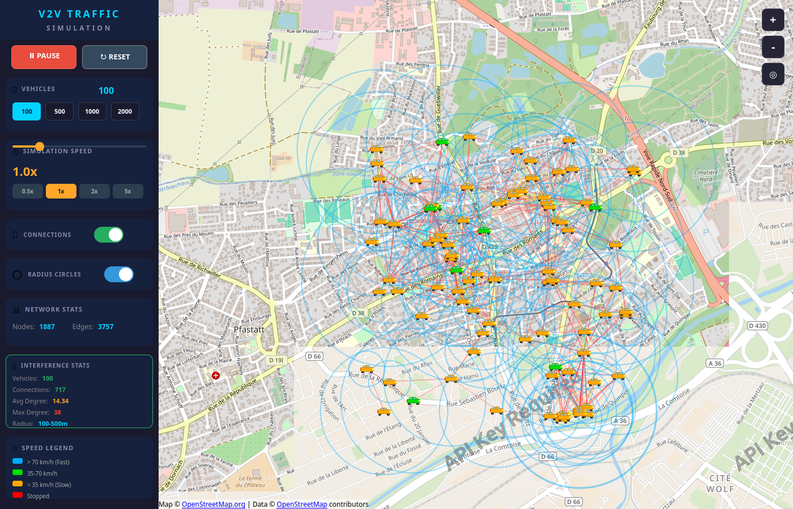
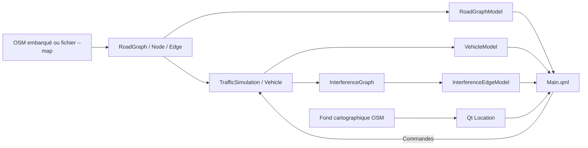

# V2V Traffic Simulation

**Mobilité OpenStreetMap et graphe de portée V2V — C++17 · Qt6 · QML**

Projet personnel de transports intelligents : une application de bureau anime des véhicules sur un réseau routier réel et visualise les liens déterminés par leur distance et leur rayon de transmission simulé.

[Présentation et téléchargements](https://v2v-traffic-observatory.freshdog256.chatgpt.site) · [Dépôt GitHub](https://github.com/arabat-med/v2v-traffic-simulation) · [Captures réelles](docs/images/README.md) · [Données et dépendances](THIRD_PARTY_NOTICES.md)

## Contexte et objectif

Le projet explore le lien entre mobilité et connectivité à travers un graphe routier OSM et un graphe de portée entre véhicules. Il permet de faire varier la population, de suivre les déplacements et d'afficher les connexions dans une seule interface Qt Quick.

**Le programme est un prototype de bureau exécutable.** Le modèle V2V est géométrique : il ne simule ni émission de messages, ni protocole réseau, ni propagation radio physique. La page web présente le projet et distribue les fichiers ; elle n'exécute pas la simulation dans le navigateur.

## Interface réelle



*Capture réelle de l'application, le 30 octobre 2026 : Ubuntu 24.04, Qt 6.8.3, carte de démonstration de Bourtzwiller, 100 véhicules et facteur affiché 1×. Les compteurs de cette scène ne constituent pas un benchmark.*

## Fonctionnalités de simulation

| Fonctionnalité | État réel | Sources |
| --- | --- | --- |
| Lecture d'un sous-ensemble OSM et construction d'un réseau orienté | Implémenté ; parseur limité | [roadgraph.cpp](roadgraph.cpp), [node.h](node.h), [edge.h](edge.h) |
| Petite carte réelle embarquée et carte externe via `--map` | Implémenté et lancement vérifié | [main.cpp](main.cpp), [data/demo.osm](data/demo.osm) |
| Points de création pondérés, parcours aléatoires et positions interpolées | Implémenté | [trafficsimulation.cpp](trafficsimulation.cpp), [vehicle.cpp](vehicle.cpp) |
| Démarrage, pause, reset, population, zoom et recentrage | Implémenté ; lancement et rendu vérifiés, recette interactive complète à poursuivre | [Main.qml](Main.qml) |
| Liens de portée, cercles et statistiques de degré | Implémenté ; recalcul différé et plafond de 5 000 liens | [interferencegraph.cpp](interferencegraph.cpp) |
| Circulation préférentielle par zone | Partiel : les zones sont calculées, mais ne contraignent pas le choix des arêtes | [vehicle.cpp](vehicle.cpp) |
| Communication V2V par paquets ou messages | Absente | Aucun composant correspondant |

Le moteur crée 20 véhicules au démarrage, en pause. L'interface propose 100, 500, 1 000 ou 2 000 véhicules et un facteur temporel de 0,1× à 5×. Ces valeurs sont des réglages, pas des performances garanties.

Chaque véhicule reçoit un rayon entre 100 et 500 mètres. Un lien non orienté est créé si `distance <= max(rayon1, rayon2)`. Sa force vaut `1 - distance / max(rayon1, rayon2)` et pilote la couleur : vert au-dessus de 0,7, jaune au-dessus de 0,4, rouge sinon. Il ne s'agit pas d'une mesure de qualité radio ou d'une portée mutuelle vérifiée dans les deux sens.

## Extension Computer Vision

**Aucune extension Computer Vision n'est implémentée dans cette version.** Aucun modèle, notebook ou traitement vidéo n'est livré.

| Technologie | Statut |
| --- | --- |
| Python applicatif, YOLO / Ultralytics, ByteTrack, OpenCV | Absents |
| FastAPI / Uvicorn, Docker / Compose, MLflow | Absents |
| Intégration C++/Python ou service de vision déployé | Absent |

Le script Python de préparation de l'archive est un outil de distribution des sources, sans traitement de vision et sans dépendance externe.

## Stack vérifiée

- **C++17** : graphes, mobilité et calculs géographiques.
- **Qt 6.8+ / Qt Quick / QML** : fenêtre, propriétés, signaux, modèles et contrôles.
- **Qt Location / Positioning** : carte, coordonnées, polylignes et cercles ; plugin OSM.
- **CMake / Ninja / CTest** : construction et vérifications.
- **OpenStreetMap XML** : réseau routier local.
- **HTML / CSS** : vitrine statique séparée de l'application.
- **Python 3, bibliothèque standard uniquement** : export de l'archive de sources ; non requis pour lancer le binaire.

## Architecture réelle



Les composants de simulation fonctionnent dans un seul processus. Les échanges C++/QML utilisent les modèles, propriétés, signaux et méthodes `Q_INVOKABLE`.

Le réseau de déplacement est embarqué ou lu sur disque. Le fond cartographique est fourni séparément par Qt Location et peut nécessiter Internet. Les arêtes de `RoadGraphModel` ne sont pas dessinées comme une couche routière dédiée.

## Organisation des sources

```text
CMakeLists.txt              Construction, tests et installation
main.cpp / Main.qml        Initialisation et interface
roadgraph.* / node.* / edge.*
vehicle.* / trafficsimulation.*
roadgraphmodel.* / vehiclemodel.* / interferencegraph.*
data/                      Petite carte réelle et provenance
tests/                     Vérifications du moteur
scripts/package-source.py  Export propre, sans historique Git
web/                       Vitrine HTML/CSS
README.md / THIRD_PARTY_NOTICES.md
docs/images/               Capture réelle et guide
.github/workflows/ci.yml    Construction et tests GitHub Actions
```

L'archive préparée contient les sources utiles, la documentation, la capture et la petite carte. Elle exclut `build/`, `.git/`, les réglages IDE, les SDK, les dépendances installées, les exécutables et les grandes cartes d'origine. Aucun fichier local historique n'est supprimé par l'export.

## Installation, compilation et exécution

### Application Linux téléchargeable

Le paquet **Linux x86_64**, disponible sur la [page de présentation](https://v2v-traffic-observatory.freshdog256.chatgpt.site), inclut le runtime Qt partagé et la carte de démonstration. Une session graphique est nécessaire. Validation effectuée sur Ubuntu 24.04 ; aucune distribution Windows ou macOS n'est annoncée.

```bash
tar -xJf v2v-linux-x86_64.tar.xz
cd v2v-traffic-simulation-linux-x86_64
./bin/appfinalproduct
```

### Construire les sources

Prérequis : compilateur C++17, CMake ≥ 3.16, Ninja et SDK Qt 6.8+ avec **Quick, Quick Controls 2, Location et Positioning**. Qt Creator est facultatif. Adapter le chemin du SDK :

```bash
git clone https://github.com/arabat-med/v2v-traffic-simulation.git
cd v2v-traffic-simulation
cmake -S . -B build/linux-release -G Ninja \
  -DCMAKE_BUILD_TYPE=Release \
  -DCMAKE_PREFIX_PATH="/chemin/vers/Qt/6.8.3/gcc_64"
cmake --build build/linux-release --parallel 2
ctest --test-dir build/linux-release --output-on-failure
./build/linux-release/appfinalproduct
```

La carte `data/demo.osm` est embarquée : ni la grande carte locale ni un répertoire courant particulier ne sont nécessaires au lancement par défaut. Les cartes d'origine restent facultatives et ne sont plus des ressources CMake obligatoires.

```bash
./build/linux-release/appfinalproduct --map /chemin/vers/carte.osm
./build/linux-release/appfinalproduct --vehicles 100 --autostart
./build/linux-release/appfinalproduct --help
```

Utiliser un répertoire de construction propre pour chaque système. Pour une installation incluant Qt, configurer avec `-DV2V_BUNDLE_QT=ON`, puis utiliser `cmake --install`. Avec le SDK Qt 6.8.3 vérifié, choisir un chemin de **construction sans espaces** pour cette étape : son script de déploiement génère une commande incorrecte lorsque ce chemin contient un espace.

## Démonstrations et vérifications

La version préparée a été construite avec **GCC 13.3.0, CMake 3.28.3, Ninja 1.11.1 et Qt 6.8.3** sur Ubuntu 24.04.

- `simulation_core` : chargement de la vraie carte, rejet de données vides/invalides, arêtes orientées, déplacement et graphe de portée.
- `application_smoke` : création de la fenêtre QML et initialisation du graphe après démarrage, en mode sans affichage.
- **Deux tests passés** lors de la vérification locale. Le workflow GitHub Actions est configuré, mais son exécution distante n'a pas été vérifiée.
- La capture PNG ci-dessus a été produite par le programme lui-même. Aucun résultat vidéo ni tableau de performances n'est fourni.

```bash
QT_QPA_PLATFORM=offscreen QT_QUICK_BACKEND=software \
  ./build/linux-release/appfinalproduct --smoke-test
./build/linux-release/appfinalproduct --vehicles 100 \
  --screenshot docs/images/01-interface-qt6-qml.png
python3 scripts/package-source.py
```

Le dernier script produit `build/distribution/v2v-source.zip` avec un manifeste SHA-256 des fichiers. Voir le [guide de capture](docs/images/README.md) pour les conditions de production des images.

## Limites et prochaines étapes

Le fonctionnement vérifié reste celui d'un prototype :

- Mobilité aléatoire, sans feux, collisions, accélération, suivi du véhicule précédent ou itinéraire optimal.
- Préférence de zone partielle ; parseur OSM limité, sans exploitation des tags `maxspeed`, de toutes les restrictions d'accès ou de `oneway=-1`.
- Pas de temps simulé indépendant de la fréquence du timer ; un véhicule peut rester bloqué à un nœud sans sortie.
- Topologie et force des liens actualisées moins souvent que leurs positions ; reset et changements de population peuvent laisser des statistiques périmées.
- Calcul et statistiques tronqués à 5 000 liens ; aucune mesure de capacité ou de latence validée.
- Pas de pipeline Computer Vision ni de serveur applicatif.

Les prochaines étapes sont la stabilisation du temps simulé et du graphe, l'application effective des zones, une recette interactive plus complète et des paquets pour d'autres systèmes.

## Auteur, données et contact

Projet personnel de [arabat-med](https://github.com/arabat-med). Contact professionnel : [moarabat131@gmail.com](mailto:moarabat131@gmail.com).

Données © OpenStreetMap et ses contributeurs, ODbL 1.0. La provenance de la petite carte est documentée dans [data/README.md](data/README.md). Les bibliothèques Qt et leurs notices sont distinctes des sources du projet ; voir [THIRD_PARTY_NOTICES.md](THIRD_PARTY_NOTICES.md).

**La licence de réutilisation du code reste à choisir.** Aucune licence MIT, GPL ou autre n'est attribuée automatiquement.
